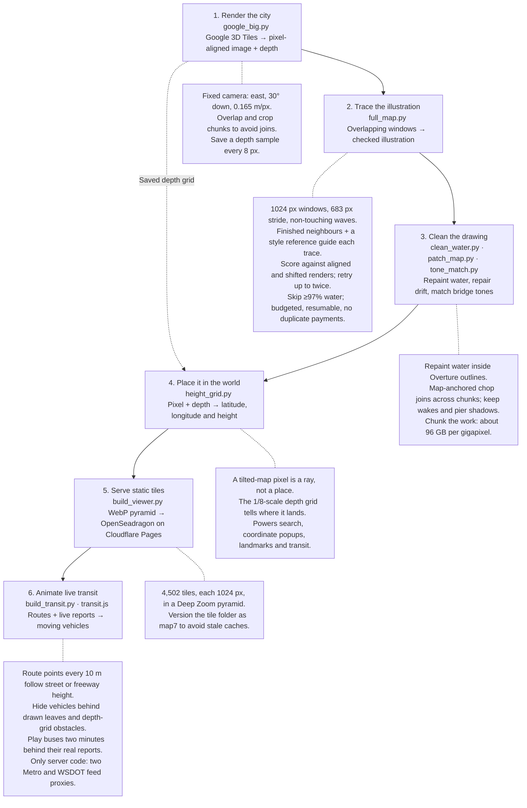
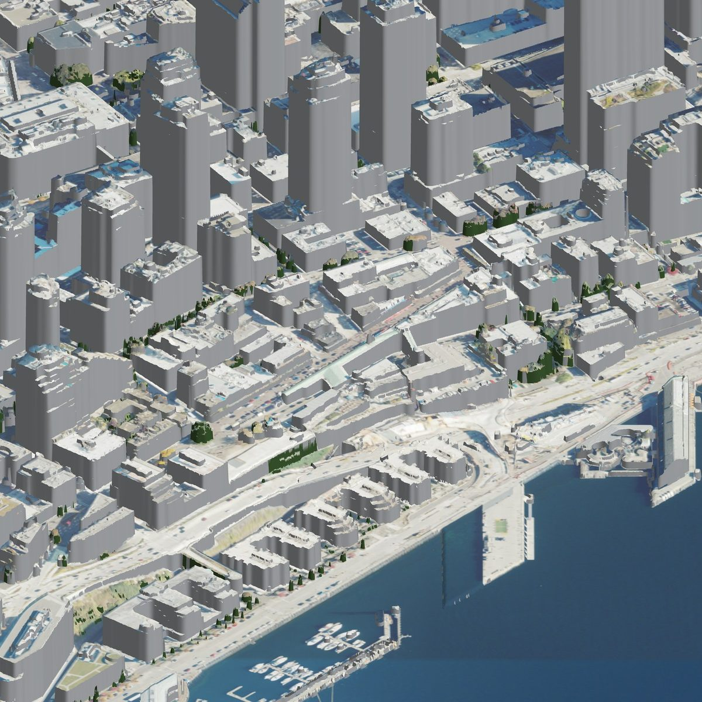
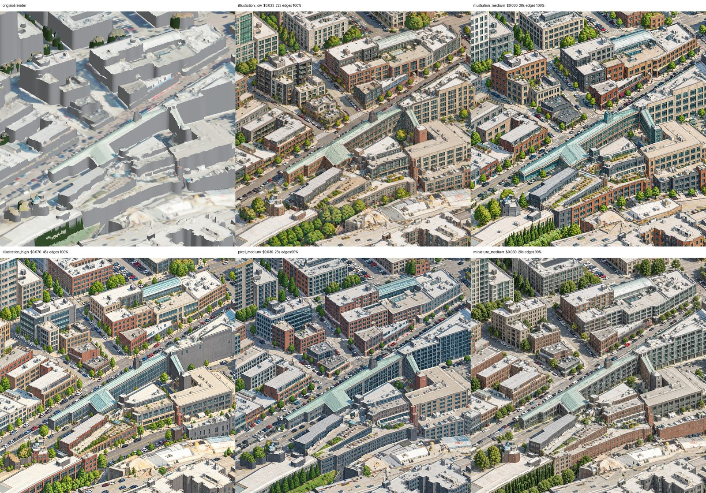
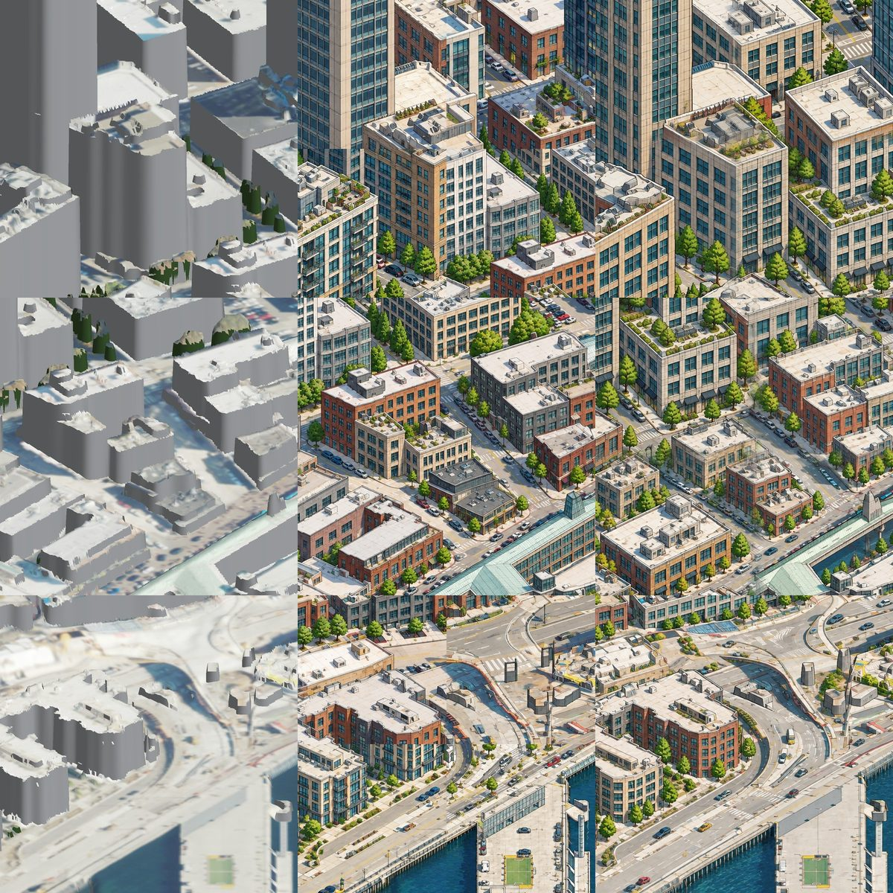
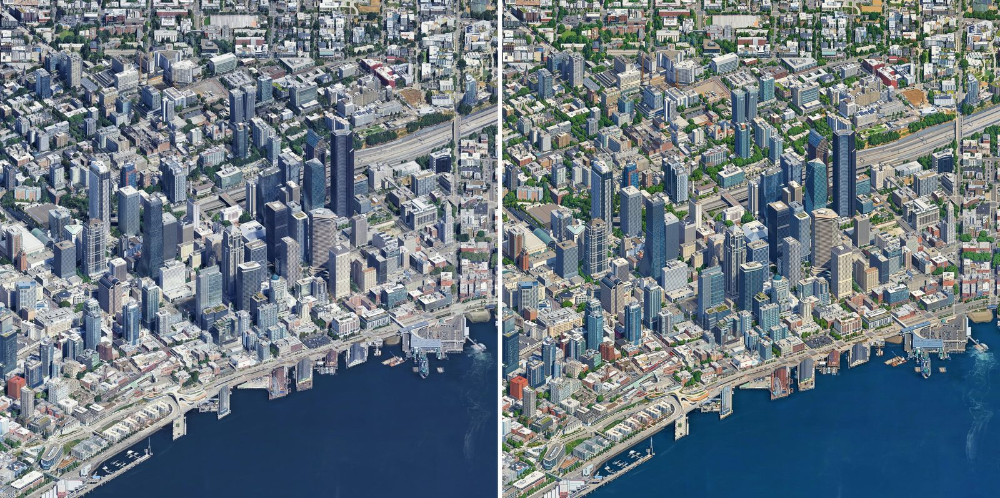
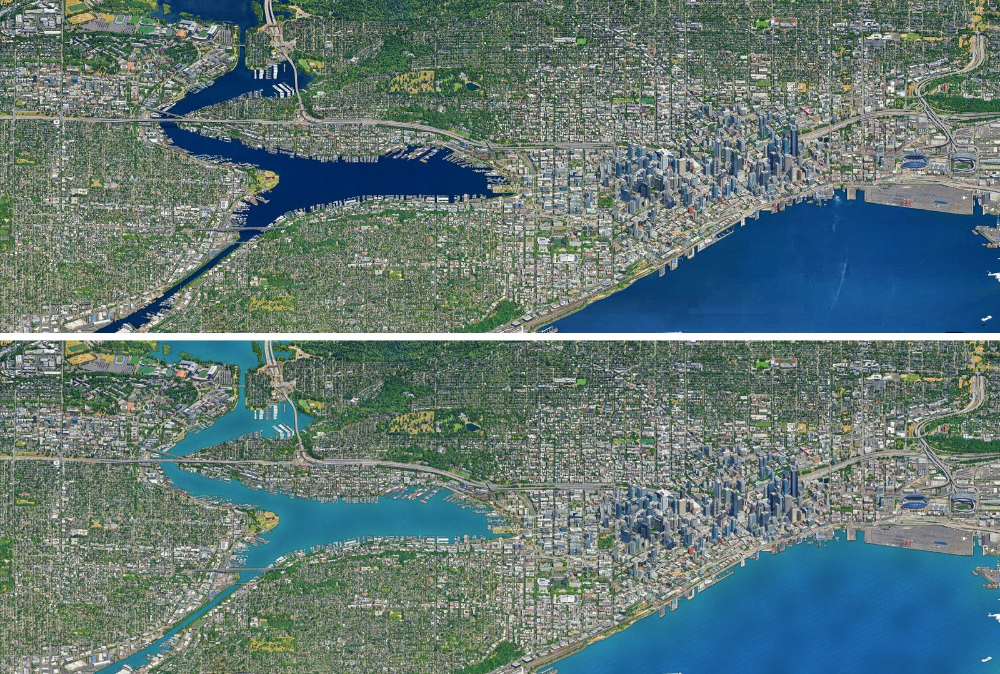
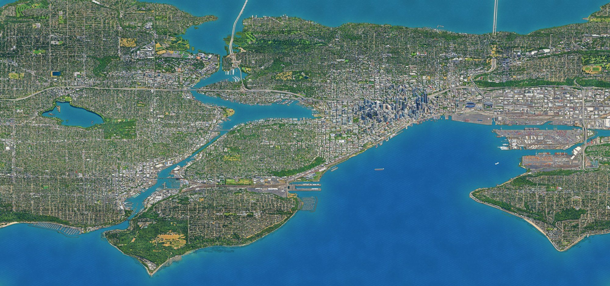
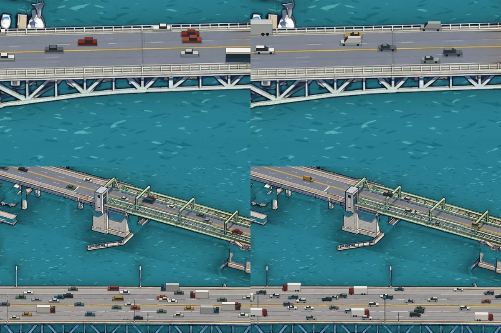
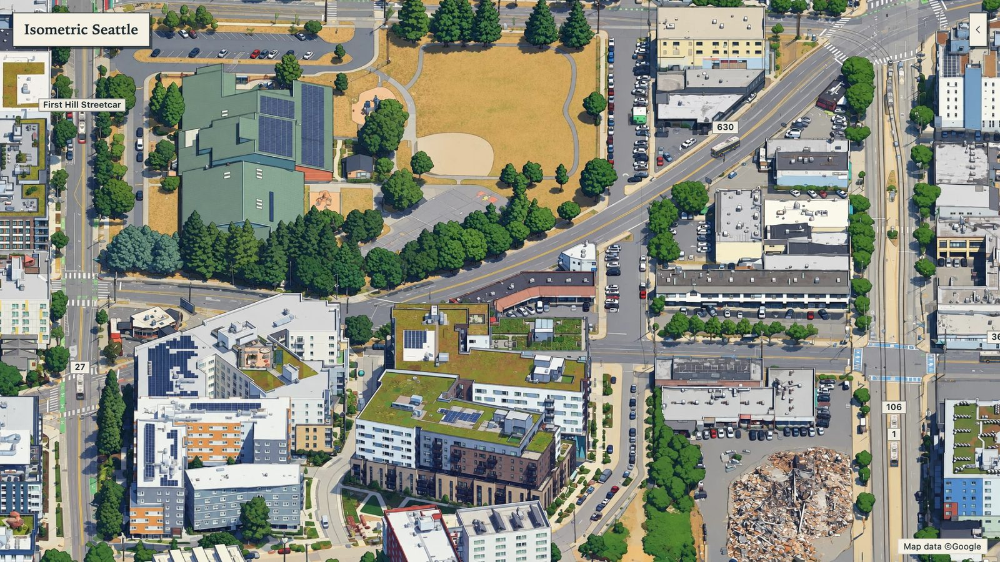

# Building Isometric Seattle

*Blog post outline · 9 November 2026*

An outline for a post on how [isometricseattle.fun](https://isometricseattle.fun) was made, and what might come next. The screenshots are the build's own leftovers, in `/media/isometric-seattle/`.

## Decided

- A long post for the usual blog audience: technical readers, so the pipeline can go as deep as it needs to.
- Leave out the Google 3D Tiles sign-off: it isn't part of how the map was built.
- What's next includes cheaper and other image models, and training one.
- Say it was built entirely with Claude Code, and mention it wherever it shaped the work, rather than as a section of its own.
- No single teaser at the end: the post closes on the What's next list.

## The hook

Seattle as one hand-drawn picture you can drag and zoom: 3.5 gigapixels, from Golden Gardens and Green Lake to Harbor Island and Alki, with the city's buses and ferries moving on it live.

- Open on the hero shot: the whole map, then a zoom to street level.
- The twist to set up early: every building was traced by an image model, over 5,000 times, for about $140.
- One line on why: an isometric city map is something people love, and nobody had drawn this one.

A thread through the whole post: it was built entirely with Claude Code. Places where that's worth a line:

- Writing the budgeted, resumable tracing runs, and the faithfulness checks that decide when a window gets redrawn.
- Hunting down water hallucinations and ghost ships across a 3.5-gigapixel image it could only look at in crops.
- The Transit layer: building the simulation, then cutting it, and debugging the jumpy buses by logging every vehicle in every frame of a capture.

## How it works

The whole thing is a straight pipeline, each step one script:

1. **Render** the city from Google's Photorealistic 3D Tiles through one fixed camera (`google_big.py`).
    - Orthographic, looking east and 30° down, at 0.165 m a pixel.
    - Far too big for one GPU frame, so it renders as pixel-aligned chunks that overlap and are cropped, leaving no joins.
    - It saves a raw depth sample every 8 px alongside the colour, for step 4.
2. **Trace** it as an illustration, window by window (`full_map.py`).
    - 1024 px windows on a 683 px stride, drawn in waves. Windows in one wave never touch, and later waves see their finished neighbours through an edit mask and continue them.
    - The prompt is a tracing brief: keep every building, tree and car exactly where and as it is, change only the drawing technique. A crop of finished map rides along as the style reference.
    - Every window is scored against the render, and then against the render shifted out of place; only the gap counts. A window that strays, or slides bodily, is realigned or redrawn, up to twice.
    - Windows that are 97% or more open water are never sent. The run has a hard budget and never pays twice for a window, so it can stop and resume.
3. **Clean** what the model can't do (`clean_water.py`, `patch_map.py`, `tone_match.py`).
    - Water is found by colour inside Overture's water outlines and repainted in one palette with generated chop, fixed to map position so chunks join. Wakes and shadows near piers carry over.
    - It paints in chunks, because one pass needs about 96 GB per gigapixel.
    - Windows the model slid get redrawn from the render, and bridge decks drawn in different colours are pulled back to the render's tone.
4. **Place** it in the world (`height_grid.py`).
    - On a tilted map a pixel is a ray, so the depth grid, at 1/8 scale, records where each ray lands.
    - From that, any pixel becomes a latitude, longitude and height. That powers search, the coordinates popup, landmarks and transit.
5. **Serve** it as static tiles (`build_viewer.py`).
    - A Deep Zoom pyramid of 1024 px WebP tiles, 4,502 in all, in OpenSeadragon on Cloudflare Pages.
    - The tile folder is versioned (`map7`), so a redraw never fights the browser's cache.
6. **Animate** it with live transit (`build_transit.py`, `transit.js`).
    - Metro's route shapes are laid every 10 m at the height of the surface the map shows: the street, or the freeway deck above it.
    - Each point is hidden where the drawing shows leaves, or the depth grid shows something in front of it.
    - In the browser, buses play two minutes behind real time between their real reports. The only server code is two small functions that pass on the Metro and WSDOT feeds.

The numbered boxes are the build stages; dotted side notes highlight the constraints and tricks behind each one.

## The build, in pictures

The repo kept almost every experiment, so the post can show the map growing up. Suggested sequence:

### 1. No AI at all

The first render came from public data: USGS LiDAR heights and aerial photos, shaded grey. It had the right shape and no soul.

### 2. Picking a style

One tile redrawn five ways, from illustration at three quality levels to miniature and pixel art, for $0.19. Illustration won.

### 3. Making tiles join

Nine tiles drawn on their own leave visible seams. Sixteen overlapping windows in four waves, each seeing its finished neighbours, join cleanly.

### 4. Better source, honest tracing

Google's 3D Tiles replaced the LiDAR render, and a strict "trace, don't invent" prompt replaced the creative one. Downtown, render and drawing side by side: 144 windows, $3.55.

### 5. The water problem

The render's water is only seams between Google's patches, and the model hallucinated on it. All open water is now repainted in one style, free.

### 6. The whole city

The canvas grew in bands (north, then Ballard, Magnolia and Capitol Hill, then east and south) to 85,952 × 40,320 px.

### 7. Moving parts

From blocky simulated cars to sprites in the map's style, and finally to live buses on real streets.

## The hard parts

Each of these is a paragraph and a before-and-after picture.

- **Seams.** The model redraws 1024 px windows, and neighbours drawn separately never quite match. The fix: overlapping windows drawn in waves. Later windows see their finished neighbours and continue them.
- **Tracing, not inventing.** Asked to "make it an illustration", the model adds trees, cars and windows that aren't there. The prompt became a tracing brief, and each window is scored against the render and redrawn if it strays.
- **Open water.** With nothing to trace, the model hallucinates on water and can slide a whole window. Water is never sent to it. Instead, a free script repaints all open water in one hand-drawn style, carrying real wakes and shadows over.
- **Ghosts and phantoms.** Moving ships show up as half-ships in Google's data, and the clean-up sometimes ate a real hull: the cargo ship and barge off Harbor Island were both repaired by hand.
- **A picture that knows where it is.** On a tilted map a pixel is a ray, not a place. A depth grid rendered alongside the map turns any pixel back into a real latitude and longitude. That powers search, the coordinates popup, and putting buses on the right street at the right height.
- **Keeping it cheap and static.** 4,502 WebP tiles behind OpenSeadragon on Cloudflare Pages. The only server code is two small functions that pass on the bus and ferry feeds.

## The Transit layer: fake traffic looked great until it didn't

The story beat: simulated motion reads as a bug on a map that is otherwise faithful to the real city, so everything that moves now has to be real.

1. **First attempt, fully simulated.** About 23,000 made-up cars on OpenStreetMap's main roads, busiest at Seattle's rush hours, plus sailboats, paddleboarders and a seaplane on the lakes. It looked great zoomed out and fell apart up close: blocky cars, cars blinking in and out behind trees, boats with no idea where the docks were.
2. **Polish that didn't save it.** Lit 3D shapes, then sprites redrawn by the same image model in the map's style, live WSDOT freeway sensors, dock-aware boat routing. Each fix was real work and the result still felt fake.
3. **The cut.** Keep only what is live: King County Metro's buses, streetcars and water taxis, and Washington State Ferries.
4. **Making live data look smooth.** Buses report about once a minute with no heading, so each route is laid on the map and every bus is played back two minutes behind real time, gliding between its real reports. It is hidden wherever the map draws trees, towers or tunnels over its street.
5. **The bugs that made it jumpy.** Route variants that overlap themselves, GPS drift off the route, late reports. The fix was a rule a bus could never break: never backwards, never faster than 90 km/h.

Video: the 15 s flyover from Colman Dock to the International District, in `/media/isometric-seattle/isometric-seattle-transit.mp4`.

### Transit data sources

| Used for | Source | Implementation in the map repo |
| --- | --- | --- |
| Route paths for Metro buses and streetcars | [King County Metro's static GTFS](https://metro.kingcounty.gov/GTFS/google_transit.zip). Only the route shapes are used, so buses follow real streets instead of jumping between position reports. | `scripts/build_transit.py:31` |
| Live bus, streetcar and water taxi positions | [King County Metro's GTFS-realtime vehicle positions](https://s3.amazonaws.com/kcm-alerts-realtime-prod/vehiclepositions.pb) | `functions/buses.js:3` |
| Live state ferry positions | [WSDOT Ferries' vessel locations API](https://www.wsdot.wa.gov/ferries/api/vessels/rest/vessellocations) | — |

The current bus and streetcar integration only fetches King County Metro data, not Sound Transit. Expanding the map to the Eastside would also mean fetching Sound Transit's route and live vehicle data; extending the canvas alone wouldn't add those services.

## By the numbers

About $140 in image-model calls drew the whole map. Every window after the first canvas was paid for once, and open water was never sent.

| Run | Windows drawn | Cost |
| --- | --- | --- |
| Experiments (style, seams, pilots, downtown) | about 210 | $5.60 |
| First canvas (`full`) | 764 | $18.80 |
| North added (`wide`) | 896 | $26.68 with patches |
| Ballard, Magnolia, Capitol Hill (`big`) | 1,391 | $35.58 with patches |
| East band (`big2`) | 1,080 | $26.56 |
| South band (`big3`) | 999 | $24.26 |
| Transit sprites | 15 sheets | $0.52 |

- The map is 85,952 × 40,320 px (3.5 gigapixels) at 0.165 m a pixel, served as 4,502 tiles.
- Median detail match against the source render was 0.91 to 0.93 on every run.
- Open water is about 40% of the canvas, and repainting it needs about 96 GB of memory per gigapixel, so it's done in chunks.
- The first commit was 6 November 2026, and the Transit layer shipped 9 November.

## What's next

Two threads: things to add to the map, and making the drawing itself cheaper so the map can keep growing. For the first, the rule from the Transit layer carries forward: add only things that are real and live. Candidates, roughly easiest first (effort is a guess, for you to correct):

| Idea | Source | Effort |
| --- | --- | --- |
| Link light rail trains | Sound Transit's GTFS-realtime feed | Small: same pipeline as the buses |
| Game days and events | Mariners, Seahawks, Sounders and Kraken schedules | Small: a crowd or glow near the stadiums |
| Other image models in place of gpt-image-2.5 | Rerun the style and faithfulness tests on a few windows from each candidate | Small to test; medium to switch |
| Ships on Elliott Bay and the Sound | AIS vessel positions (container ships, tugs, the Victoria Clipper) | Medium: needs ship sprites by type |
| Planes into Boeing Field and seaplanes on Lake Union | ADS-B flight positions | Medium: altitude, and shadows on the map |
| The real sun and weather | Sun position by time of day; current conditions | Medium: a lighting and fog pass over the tiles |
| Prints and posters | The full-size map | Medium: print-resolution export and a store |
| Training a cheaper model of my own | The 5,000-odd render and drawing pairs already on disk are a ready training set | Large: fine-tune an open image model, then compare it on the faithfulness score |
| Growing the map | Eastside, West Seattle and more of the north; Eastside transit also needs Sound Transit data, since the current bus and streetcar feeds are Metro-only | Large: new renders and tracing, plus Sound Transit integration for the Eastside; tracing far cheaper with a trained model |

The post closes on this list as it stands, with no single teaser.
