This week, I built [Isometric Seattle](https://isometricseattle.fun): a 3.5-gigapixel illustrated map of my hometown, with live buses and ferries.

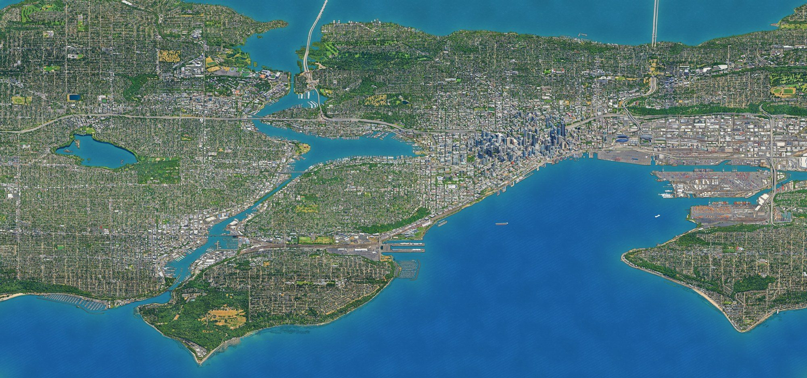

I [tweeted about it](https://x.com/dmarticus/status/2119169865286316309?a=sCvvH-sLvF8ATfVs-KE&s=20) and got some decent engagement (for me), so I wanted to take some time to write up how I did it.

I've been trying to do more ambitious things with AI, especially projects I wouldn't ordinarily know how to start. I'd seen a few isometric city maps on twitter in the last week, noticed that there wasn't one for Seattle, and figured I could try and close that gap (I also wanted to channel my innner [Fran Lebowitz](https://www.untappedcities.com/filming-locations-pretend-its-a-city/)).

This entire project was me driving Claude, but the point of this post is to point out some things I learned about the process so that future projects don't have to ideate on this from scratch.

## Nailing the rendering strategy

My first attempt combined LiDAR heights with aerial photos to get a grey isometric render of downtown. This gave me a decent city shape (and was free!), but the details were super sparse.

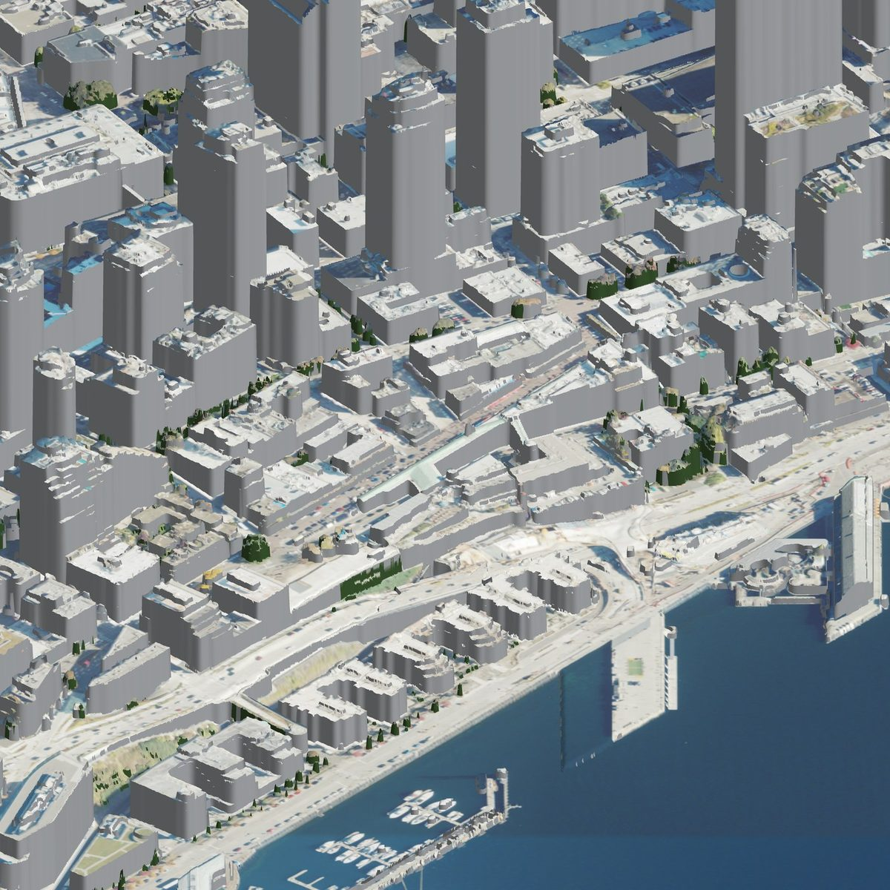

Still, I had enough of shape to test out some art styles on it, so I tried a few, and `illustration_high` was my favorite.

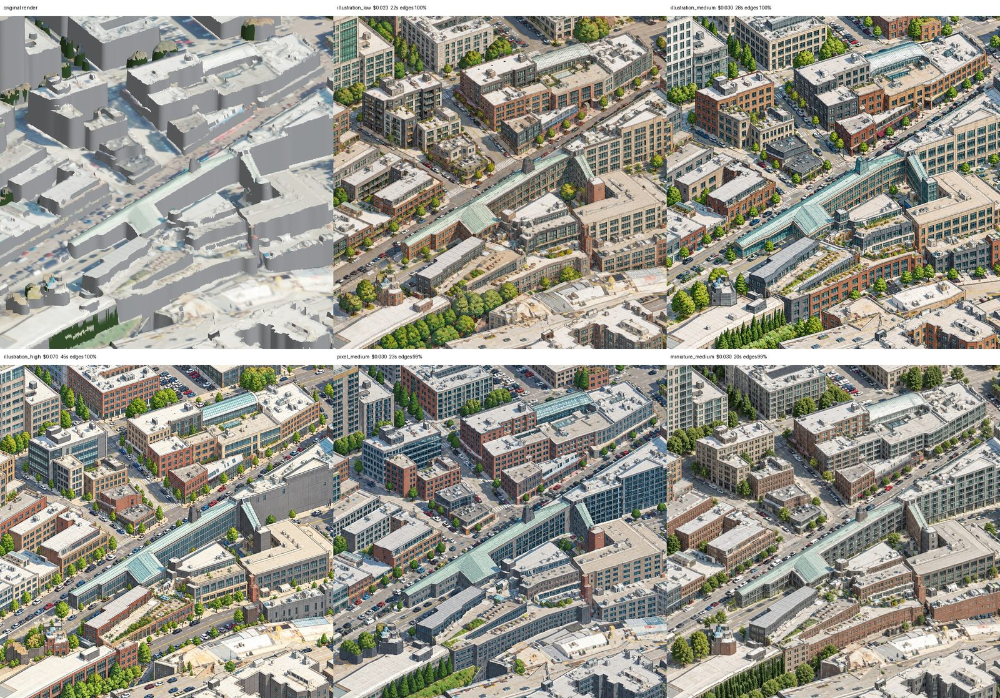

I also noticed that drawing adjacent tiles independently left obvious gaps between tiles. To fix that, I used overlapping "windows", i.e. tiles drawn in waves, where later windows see their finished neighbors and continue the drawing.

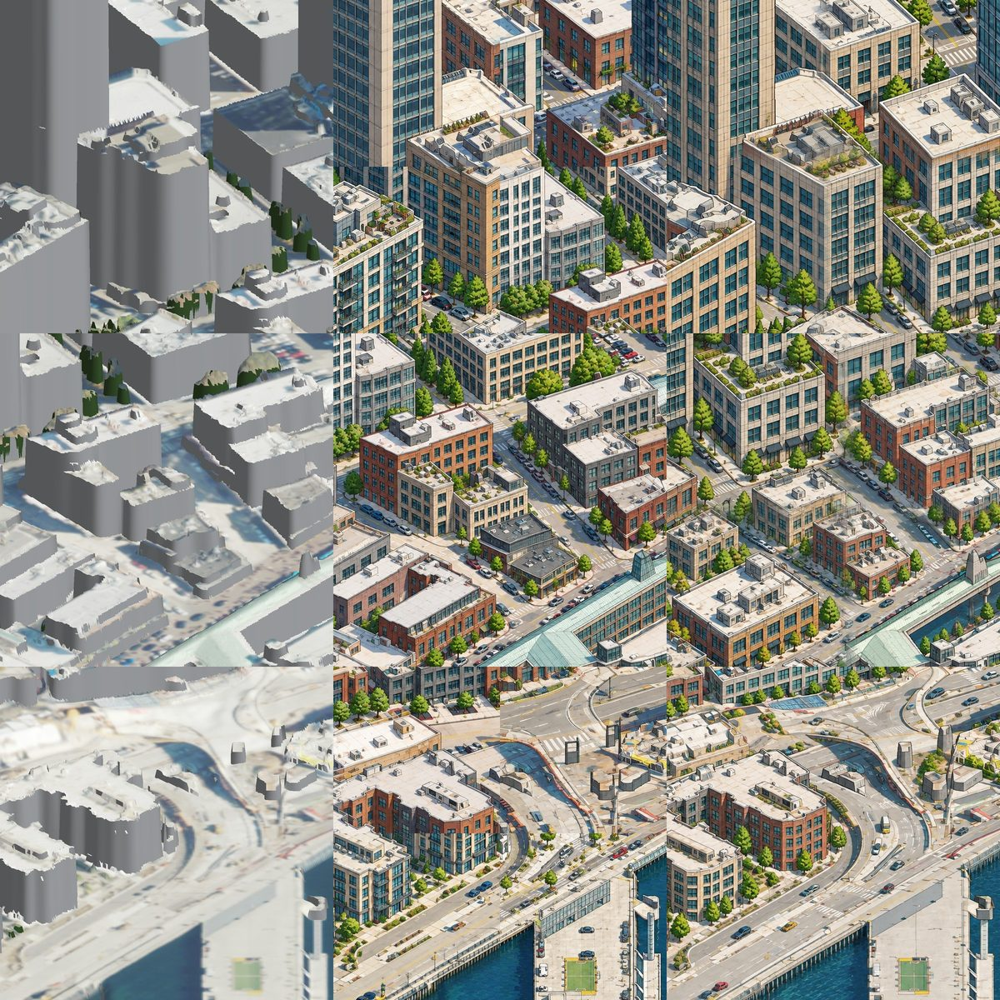

Once I got my tiling overlapping + illustration style sorted, though, I needed to fix the hallucination problem. As the real Seattle-knowers could probably tell from the first few images, the model was inventing too many fake details about the buildings it was trying to draw when only using the LiDAR data. I needed a better source. Fortunately, I was able to use [Google's Photorealistic 3D Tiles](https://developers.google.com/maps/documentation/tile) to build a much more robust rendering – this service gave me textured facades, trees and detailed geometry to trace instead of blank grey walls.

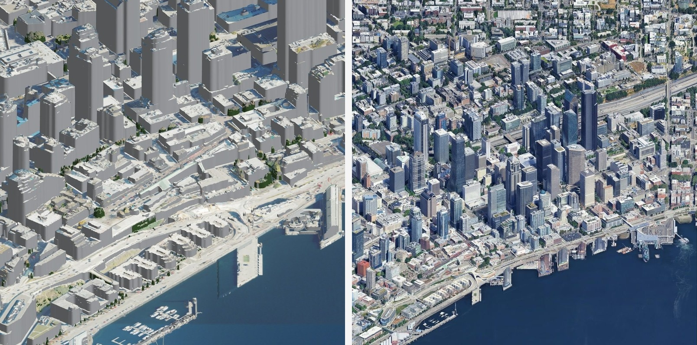

This let me modify my prompt to do more tracing and less generation, the tl;dr was: preserve the buildings and their positions, and change the drawing style to be `illustation_high` instead of the photorealistic image. Each result gets checked against its source and retried if it drifts.

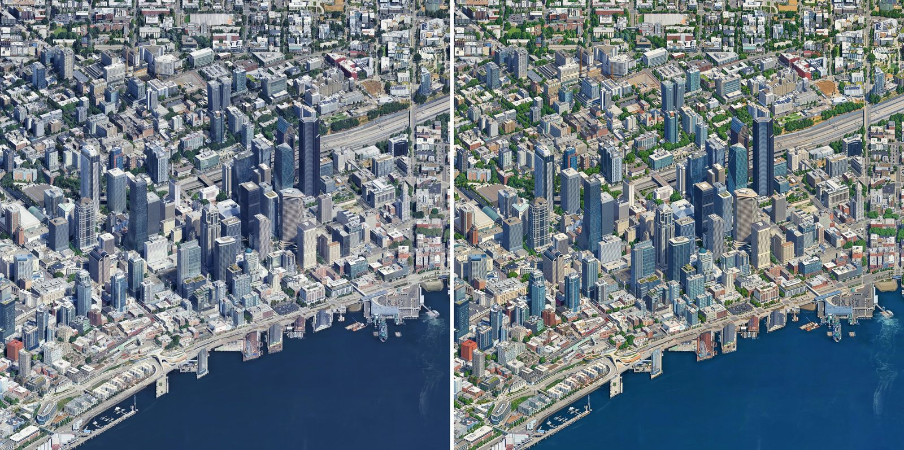

Another problem I had was rendering water. Google's source had patchy coverage, and asking the model to redraw it wasn't helping. I stopped sending mostly-water windows to the image model and repainted the water in one consistent style. Boats needed manual touchups.

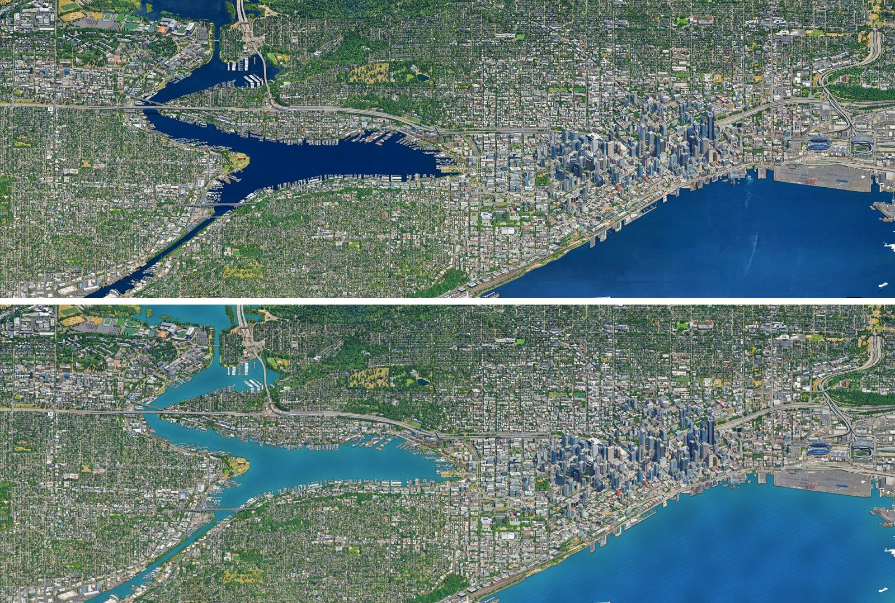

## Giving pixels coordinates

Next I wanted to do location search, and give users a way to see where a point on the map actually was.

The source render already had a depth grid, which I could combine with the camera geometry to give each pixel a latitude, longitude and height. That turned out to be enough enough to place search results, show coordinates, and it laid the groundwork for putting put transit on the right streets (and bodies of water).

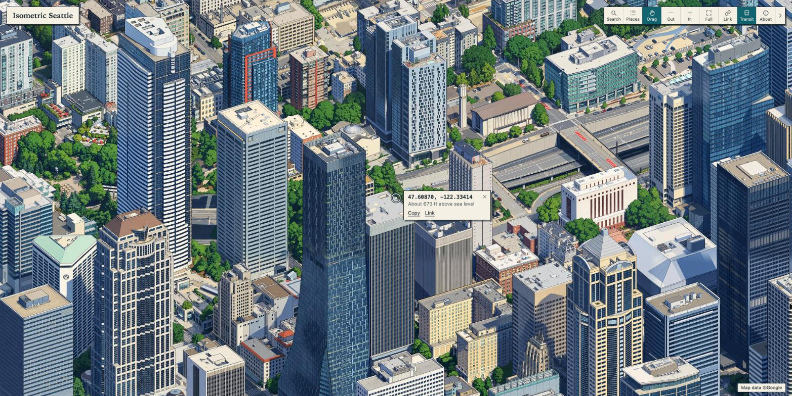

## Adding transit

I pulled live vehicle data from King County Metro and WSDOT's ferry API, then made custom bus and ferry sprites because I didn't like the default blocky ones.

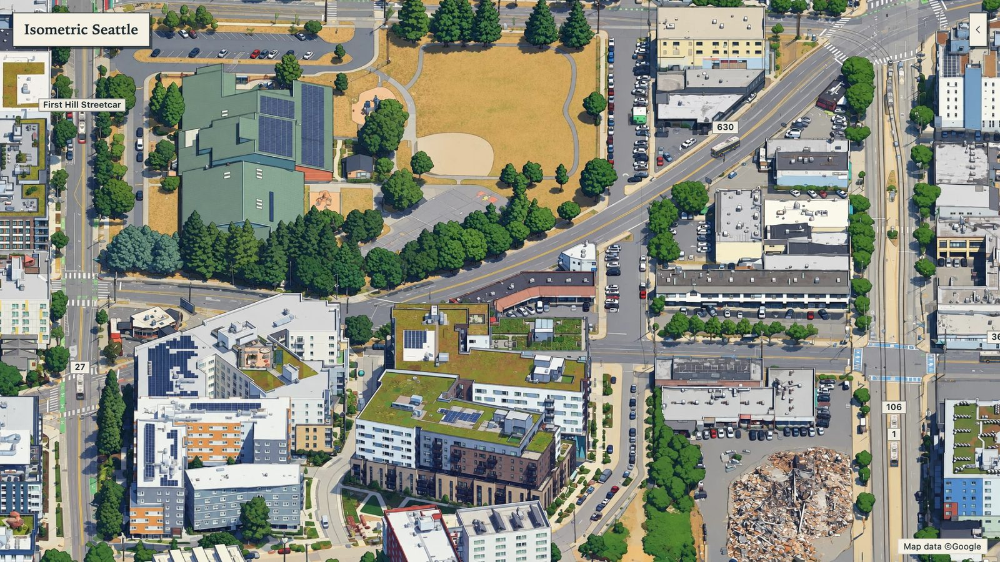

I had to engineer around the actual data feeds a bit (the bus feed updated roughly once a minute, without any sort of heading), so to make the routes look smoother, I:

- Laid the route over the map.
- Played reports back two minutes behind real time.
- Added glide along the route between updates.
- Hid vehicles (read: made them disappear from the map) behind trees, buildings and tunnels.

Ferries were easier to render since their route was over open water, all I had to do was add some extra handling near the docks so they didn't sit there awkwardly.

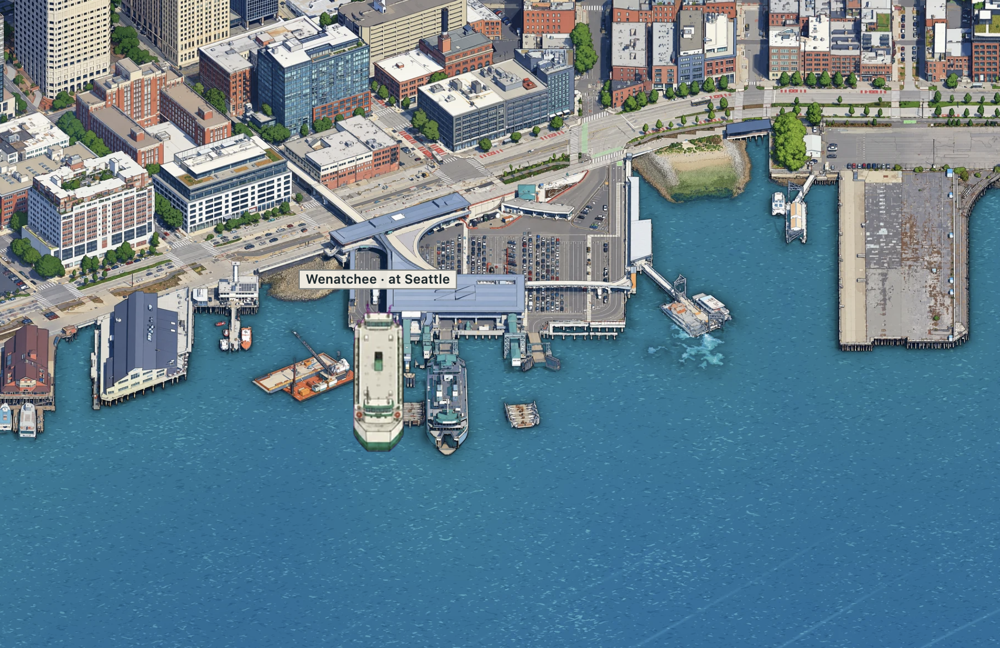

I also tried simulated car traffic, but I dropped it (for now). It was cool, and made the map loop alive from a distance, but when I zoomed in it looked too busy, and too chaotic for my taste. Cars were leaving roads, breaking traffic laws, disappearing and popping in a lot, and it was a pain to make a variety of sprites that I was happy with. Buses still have some of these issues re: traffic patterns, but there are fewer of them. I want to bring cars back if I can get them to behave.

## Image generation pipeline

Claude wrote all the code and I didn't read it, but for anyone interested in the architecture, here's the "pipeline" (it's a series of python scripts).

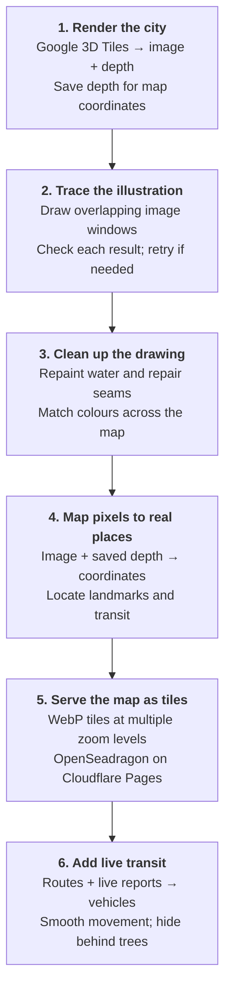

Hover over a step, focus it with the keyboard, or tap it for details.
{: .mermaid-step-hint}

1. **Render the city.** `google_big.py` turns Google 3D Tiles into an image and a matching depth grid. The camera faces east, tilted 30° down, at 0.165 metres per pixel. Overlapping chunks are cropped to avoid joins, and a depth sample is saved every 8 pixels for step 4.

2. **Trace the illustration.** `full_map.py` draws overlapping 1024-pixel windows, spaced 683 pixels apart, in non-touching waves. Finished neighbours and a style reference guide each drawing. Each result is scored against aligned and shifted renders, with up to two retries. Windows that are at least 97% water are skipped; the job is budgeted and resumable, without duplicate payments.

3. **Clean up the drawing.** `clean_water.py`, `patch_map.py` and `tone_match.py` repaint water, repair drift and match bridge tones. Water follows Overture outlines, with map-anchored chop that joins across chunks while preserving wakes and pier shadows. The work runs in chunks because it needs about 96 GB per gigapixel.

4. **Map pixels to real places.** `height_grid.py` uses the saved depth grid to find each pixel's latitude, longitude and height. A pixel in a tilted image is a ray, not a location; the 1/8-scale depth grid tells you where it lands. This powers search, coordinate popups, landmarks and transit placement.

5. **Serve the map as tiles.** `build_viewer.py` exports 4,502 WebP tiles, each 1024 pixels across, in a Deep Zoom pyramid. OpenSeadragon displays them on Cloudflare Pages. The tile folder is versioned as `map7` to avoid stale caches.

6. **Add live transit.** `build_transit.py` and `transit.js` combine routes with live reports to move vehicles. Route points every 10 metres follow street or freeway height; drawn leaves and depth-grid obstacles hide vehicles where appropriate. Buses play two minutes behind their real reports. The only server code is two Metro and WSDOT feed proxies.
{: .mermaid-step-details data-mermaid-nodes="render trace clean place serve animate"}

## The numbers

This project cost about $140 in image-model calls, mostly for the large canvas runs (I ran those overnight on November 7 and 8).

| Run | Windows drawn | Cost |
| --- | --- | --- |
| Experiments (style, seams, pilots, downtown) | about 210 | $5.60 |
| First canvas (Downtown) | 764 | $18.80 |
| North (Greenlake, Wallingford) added | 896 | $26.68 with patches |
| Ballard, Magnolia, Capitol Hill | 1,391 | $35.58 with patches |
| East band | 1,080 | $26.56 |
| South band | 999 | $24.26 |
| Transit sprites | 15 sheets | $0.52 |

- The map is 85,952 × 40,320 px (3.5 gigapixels) at 0.165 m a pixel, served as 4,502 tiles.
- Median detail match against the source render was 0.91 to 0.93 on every run.
- Open water is about 40% of the canvas, and repainting it needs about 96 GB of memory per gigapixel, so I repaint in bigger chunks than I do for tiles.

## Future iteration

Here's a fwe more things I'd like to build, assuming my ambition and wallet cooperate:

- Link light rail trains
- Game days and events
- Other image models in place of gpt-image-2.5
- Ships on Elliott Bay and the Sound
- Planes into Boeing Field and seaplanes on Lake Union
- The real sun and weather
- Prints and posters
- Training a cheaper model of my own (this will actually be a pocketbook-positive activity)
- Further expanding the map to the eastside

But yeah, this was a lot of fun, AI is wild, and it's so fun to go from idea to finished product faster than I ever thought possible.
